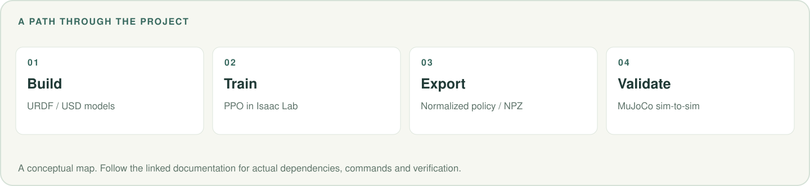
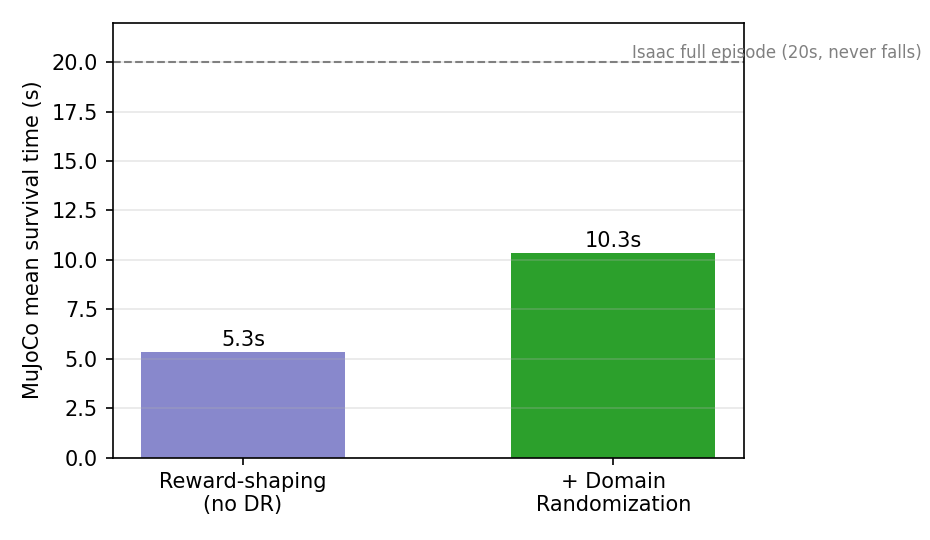
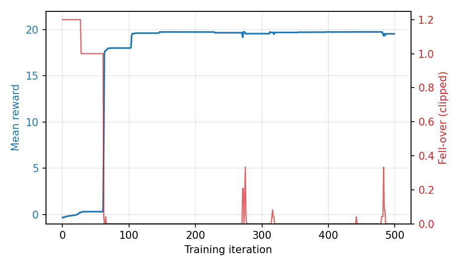
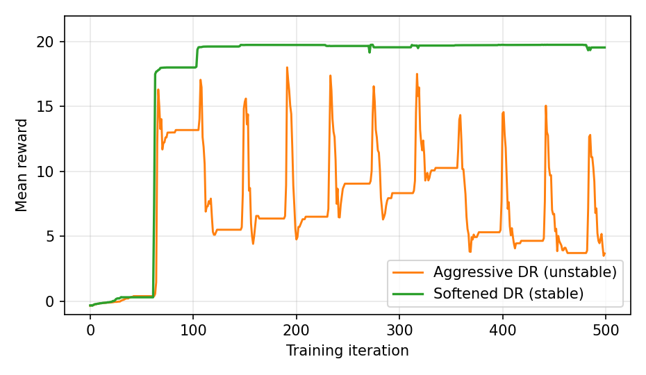

# Two-Wheel Balance · Deep RL


[](LICENSE)

[](https://oye-li-bc.github.io/)

> Deep Reinforcement Learning for Self-Balancing Control of a Two-Wheeled Mobile Robot

用近端策略优化（PPO）在 **NVIDIA Isaac Lab**（PhysX）大规模并行仿真中，端到端学习仅靠两轮力矩保持车身直立的控制策略，无需精确解析动力学建模；随后迁移部署到 **MuJoCo** 做 sim-to-sim 验证，形成从建模、训练到跨仿真器部署的完整闭环。

**[实验结果](#results) · [结果图表](#figures) · [快速开始](#quickstart) · [技术报告](docs/report.pdf) · [详细复现](src/balance_rl/README.md)**

<picture>
  <source media="(max-width: 600px)" srcset=".github/readme/workflow-mobile.svg">
  
</picture>

## 亮点

- **端到端 PPO 平衡控制**：观测 13 维 → 动作 2 维（左右轮力矩），策略网络仅 `13-64-64-2`，具备嵌入式实时部署潜力。
- **奖励塑形修正退化解**：增设水平速度惩罚项，消除"直立前溜"退化解，使策略真正原地驻停。
- **训练稳定性根治**：对数参数化标准差 + 在线经验归一化，根除浮动基座任务的 NaN 崩溃。
- **域随机化提升鲁棒性**：随机化摩擦、连杆质量、关节参数并施加周期外力，MuJoCo 迁移下平均维持时间近乎翻倍。
- **sim-to-sim 部署**：将观测归一化解析折叠进网络首层（误差 <1e-7），部署端纯 numpy 前向，无需 torch。

<a id="results"></a>

## 关键结果

| 指标 | 初版策略 | + 奖励塑形 + 域随机化（修正模型） |
|---|---|---|
| MuJoCo 平均维持时间 | 4.8 s | **10.3 s** |
| 车身平均倾角 | 7.4° | **≈4°** |

Isaac（训练器）中策略可无限期保持平衡并从随机推力中恢复。详见 [`docs/report.pdf`](docs/report.pdf)。


<a id="figures"></a>

## 结果图表

以下为仓库已有的实验图，图中配置与统计口径见[技术报告](docs/report.pdf)。



<details>
<summary>展开训练曲线与稳定性对比</summary>





</details>

<a id="structure"></a>

## 目录结构

```
two-wheel-balance-rl/
├── src/balance_rl/          # 训练/回放/导出/部署/验证代码
│   ├── two_wheel_env_cfg.py     # 平衡任务环境配置（观测/动作/奖励/域随机化）
│   ├── ppo_cfg.py               # PPO 超参数
│   ├── train.py / play.py       # 训练入口 / Isaac 中回放
│   ├── export_policy.py         # .pt → 部署用 .npz（折叠观测归一化）
│   ├── verify_balance.py        # 无窗口量化验证（存活率/倾角/漂移）
│   ├── deploy_mujoco.py         # MuJoCo 开窗部署（纯 numpy 前向）
│   ├── logs/two_wheel_balance/  # 训练模型 model_final.pt
│   ├── policy_actor.npz         # 导出的部署策略
│   └── README.md                # 详细复现步骤
├── models/two_wheel_robot/  # 机器人模型：URDF / USD / MuJoCo XML / STL 网格
├── docs/                    # 技术报告（docx/pdf）、配图与生成脚本
└── requirements.txt
```

<a id="quickstart"></a>

## 快速开始

**环境**：Ubuntu 22.04 + NVIDIA GPU（CUDA 12.8）+ Isaac Lab 2.1.0（PhysX）+ Python 3.10。
训练/回放/导出需在 Isaac Lab 的 conda 环境下经 `isaaclab.sh` 运行；MuJoCo 部署/验证用系统 Python 即可。

```bash
# 1) 训练（约数分钟）
./isaaclab.sh -p src/balance_rl/train.py --headless --max_iterations 500

# 2) 导出策略给 MuJoCo（自动折叠观测归一化）
python src/balance_rl/export_policy.py

# 3) sim-to-sim 量化验证（系统 Python 即可）
python src/balance_rl/verify_balance.py --trials 20 --episode 20

# 4) MuJoCo 中开窗观看
python src/balance_rl/deploy_mujoco.py
```

更详细的运行环境与复现步骤见 [`src/balance_rl/README.md`](src/balance_rl/README.md)。

## 数据来源

无外部数据集：训练数据由 Isaac Lab 仿真在线自采集（4096 个并行环境交互产生），无需下载或预处理。

## 许可证

本项目基于 [MIT License](LICENSE) 开源。

---

[个人作品集](https://oye-li-bc.github.io/) · [封面来源与配图说明](.github/readme/README.md)
